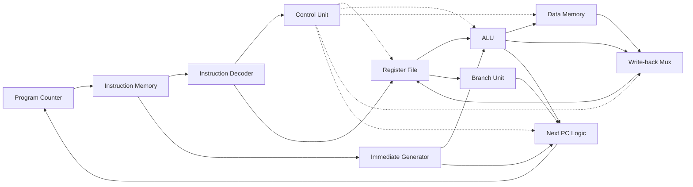

# RISC-V Softcore Processor

A single-cycle **RV32I** RISC-V processor written in **SystemVerilog**, verified against the official RISC-V compliance tests, and running on a **Xilinx Zynq-7020 FPGA** (ZedBoard).

| | |
|---|---|
| **ISA** | RV32I: all 37 base integer instructions used by programs |
| **Microarchitecture** | Single-cycle (one instruction per clock), Harvard memories |
| **Verification** | Self-checking testbenches for every module, plus the official [riscv-tests](https://github.com/riscv-software-src/riscv-tests) rv32ui suite: **40/40 passing** |
| **FPGA** | ZedBoard (Zynq-7020), Vivado 2023.2: timing met at **25 MHz**, Fmax ≈ **53 MHz** |
| **Toolchain** | Programs written in RISC-V assembly, built with RISC-V GCC |

## Architecture



Every instruction completes in one clock cycle: fetch, decode, register read, execute, memory access, and write-back all happen between two clock edges.

- **Control unit + datapath:** `control_unit.sv` decodes the opcode and function fields into control signals; the datapath modules do the work.
- **Harvard memories:** separate 4 KB instruction and data memories, so a load can access data in the same cycle its instruction is fetched.
- **Shared definitions:** opcodes, ALU operations, and mux selects are SystemVerilog enums in `riscv_pkg.sv`.
- **Memory system:** byte-addressable, little-endian data memory supporting byte, halfword, and word loads (signed and unsigned) and stores.

### Supported instructions

| Group | Instructions |
|---|---|
| Arithmetic / logic (register) | `add` `sub` `and` `or` `xor` `sll` `srl` `sra` `slt` `sltu` |
| Arithmetic / logic (immediate) | `addi` `andi` `ori` `xori` `slli` `srli` `srai` `slti` `sltiu` |
| Loads | `lb` `lh` `lw` `lbu` `lhu` |
| Stores | `sb` `sh` `sw` |
| Branches | `beq` `bne` `blt` `bge` `bltu` `bgeu` |
| Jumps | `jal` `jalr` |
| Upper immediates | `lui` `auipc` |

`fence` executes as a no-op. System instructions (`ecall`, `ebreak`, CSRs) are not implemented.

## Verification

- **Unit testbenches:** each module has a self-checking testbench (`*_tb.sv`) that stops with an error on the first mismatch.
- **Program tests:** `cpu_tb.sv` runs a hand-checked program covering every instruction type, and `fibonacci_tb.sv` runs a program until it halts and checks memory.
- **Official compliance suite:** `tests/riscv-tests/` builds the official rv32ui tests with a custom test environment (this CPU has no traps or CSRs), and `riscv_tests_tb.sv` runs each one. **40 of 40 pass.**
  - Skipped: `fence_i` (needs writable instruction memory) and `ma_data` (misaligned access, optional in RV32I).
- **X-propagation checks:** the compliance testbench checks every cycle that no unknown (`x`) value reaches a register or a branch decision, and that the PC stays aligned. In simulation, a branch on `x` acts as "not taken", which could otherwise let a broken test report a pass.
- **Mutation testing:** deliberately broken versions of the design (wrong shift type, signed/unsigned mix-ups, wrong immediates, undersized memory) were used to confirm the tests catch real bugs.

## Running on the FPGA (ZedBoard)

`fpga/fpga_top.sv` wraps the CPU for the board:

- **Clock:** an MMCM turns the 100 MHz oscillator into a 25 MHz CPU clock.
- **Inputs:** the reset button and switches pass through two-flip-flop synchronizers.
- **Register viewer:** the switches select any register (or the PC), and the 8 LEDs show one byte of it.
- **Speed:** full speed, or a slow mode of 4 instructions per second for watching the PC step.

| Control | Function |
|---|---|
| `SW[4:0]` | Register to display (`00000` shows the PC) |
| `SW[6:5]` | Which byte of it (0 = bits 7:0 … 3 = bits 31:24) |
| `SW7` | 1 = full speed (25 MHz), 0 = slow mode |
| `BTNC` | Reset |

With the `led_counter` program and the switches set to `1 00 01010` (full speed, register x10), the LEDs count up in binary.

**Timing:** worst negative slack is 21.4 ns at 25 MHz, so the critical path is about 18.6 ns (Fmax ≈ 53 MHz). The limit is the single-cycle path from the PC through instruction memory, decode, the register file, the ALU, data memory, and write-back.

## Repository layout

```
├── riscv_pkg.sv               Shared enums (opcodes, ALU operations, mux selects)
├── cpu.sv                     Top level: connects every part of the processor
├── program_counter.sv         PC register (reset, +4, or jump target)
├── instruction_fetch.sv       PC + instruction memory
├── instruction_memory.sv      4 KB program memory, loaded from a hex file
├── instruction_decoder.sv     Splits an instruction into its fields
├── immediate_generator.sv     Builds I/S/B/U/J immediates
├── control_unit.sv            Turns opcode/funct fields into control signals
├── register_file.sv           x0-x31 (two read ports, one write port, debug port)
├── alu.sv                     The 10 RV32I ALU operations
├── branch_unit.sv             Branch conditions
├── data_memory.sv             4 KB byte-addressable data memory
├── *_tb.sv                    Testbenches
├── programs/                  Assembly programs (.s) and their built hex files
├── tests/riscv-tests/         Official rv32ui tests, test environment, build/run scripts
└── fpga/                      ZedBoard top level, clock generation, constraints, Vivado scripts
```

## Getting started

**Tools:**
- [Icarus Verilog](https://steveicarus.github.io/iverilog/) for simulation (`-g2012` SystemVerilog support)
- [xPack RISC-V GCC](https://xpack-dev-tools.github.io/riscv-none-elf-gcc-xpack/), only needed to rebuild programs; the built `.hex` files are included
- AMD Vivado (2023.2 used), only needed for the FPGA

The PowerShell scripts set tool paths at the top; edit them to match your install.

**Run the CPU testbench:**

```powershell
iverilog -g2012 -s cpu_tb -o cpu_sim riscv_pkg.sv alu.sv register_file.sv program_counter.sv instruction_memory.sv instruction_fetch.sv instruction_decoder.sv immediate_generator.sv control_unit.sv data_memory.sv branch_unit.sv cpu.sv cpu_tb.sv
vvp cpu_sim
```

**Run the official compliance tests:**

```powershell
.\tests\riscv-tests\build.ps1     # build the tests (hex files are included)
.\tests\riscv-tests\run.ps1       # expect: 40 passed, 0 failed
```

**Build a program:**

```powershell
.\programs\build.ps1 programs\fibonacci.s
```

**Build and load the FPGA design:**

```powershell
.\fpga\build.ps1 led_counter      # synthesis, implementation, bitstream; prints worst slack
.\fpga\program.ps1                # program the ZedBoard over JTAG (PROG USB port)
```

## License

The files in `tests/riscv-tests/isa/` are from [riscv-tests](https://github.com/riscv-software-src/riscv-tests) and are covered by their BSD license (`tests/riscv-tests/LICENSE`).
